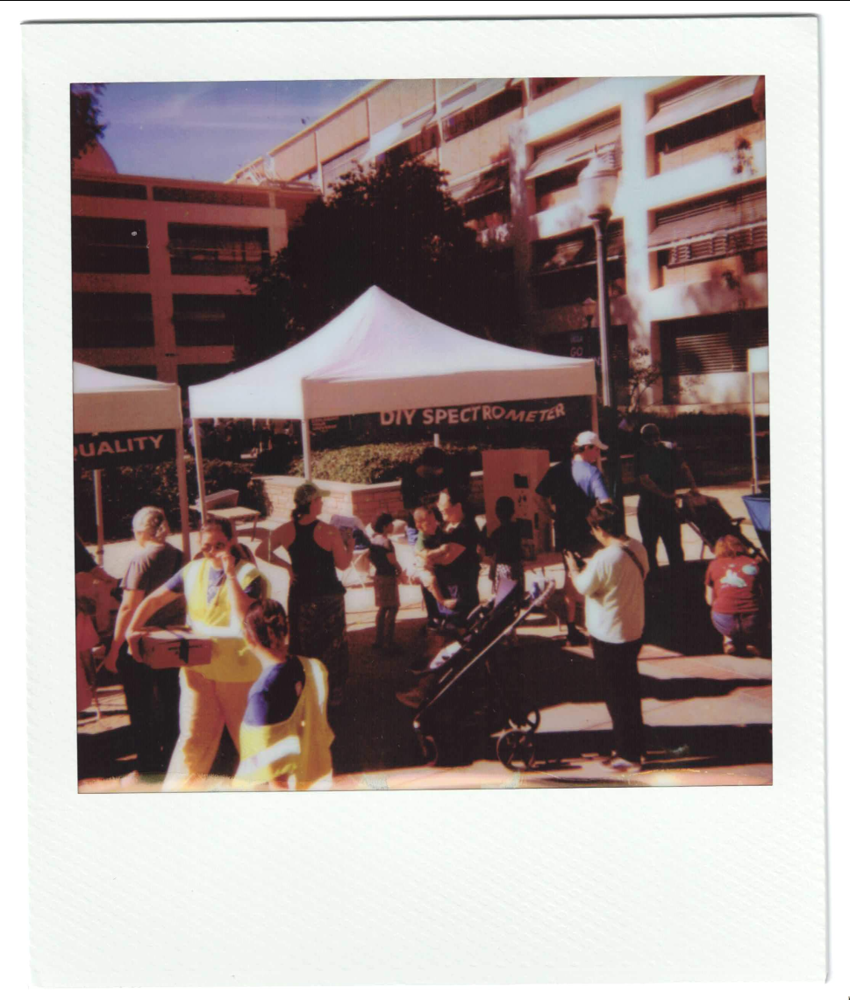

# eyu-2026-diy-spectrometer

DIY spectrometer! This project is a collection of resources and files to build a
DIY spectrometer. License is GPL3 (see [LICENSE](./LICENSE)).

## Contents:

1. [Instructions to assemble your own spectroscope](./spectroscope/DIY%20Spectrometer%20Instructions.pdf)
   (spectroscope dir)
2. [3D print files and instructions](./spectrometer/README.md) for the waveguide
   spectrometer (spectrometer dir)

**Note:** the FreeCAD and STL files in `spectrometer/` are scaled 10x from
actual size — scale down 10x before printing.

## Useful links:

1. https://github.com/DerFetzer/spectro-cam-rs Awesome spectrometer app that
   works on any platform
2. https://www.theremino.com/downloads Classic spectrometer software if you're
   on Windows.
3. https://www.youtube.com/watch?v=fW4aMOSVv_8 Great video that shows you how
   to make your own spectroscope! We used it as a reference for our
   instructions.
4. https://github.com/GaudiLabs/3DFiberSpectrometer The spectrometer that we
   used for reference. Many thanks to the creators!
